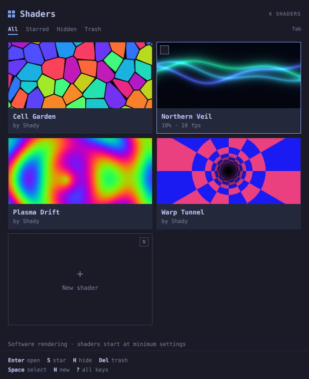
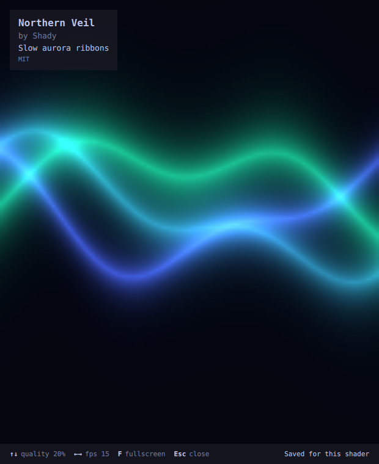
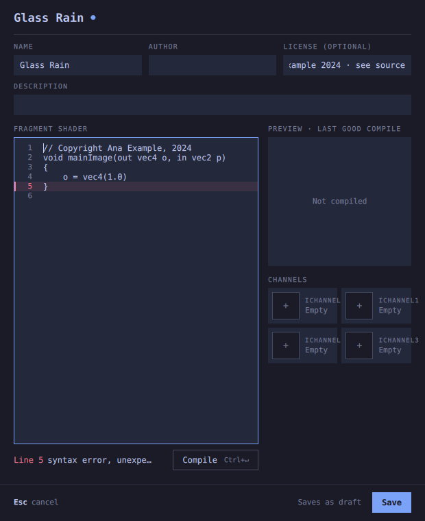

# Shady

Shady runs Shadertoy-style GLSL shaders as a screensaver or in a window on
[Omarchy](https://omarchy.org). It's calm and keyboard-first: the theme
recolours the layout, the shaders supply all the colour.

Designed together by [Allan Kristensen](https://github.com/allandehn) and [Grok](https://x.ai).

> Early version: list, Trash, editor, viewer, per-shader settings and
> Settings work. iChannels, multi-select and screensaver mode come next.

## Build

Needs Qt 6.6+ (`qt6-base`, `qt6-declarative`, `qt6-shadertools`), CMake and Ninja.

    cmake -S . -B build -G Ninja
    cmake --build build
    ./build/shady

Options: `--self-test`, `--ui-test [--screenshot out.png]`, `--version`.

## Keys

Press `?` in the list for all of them.

List: `←→↑↓` move · `Enter` open · `N` new · `Ctrl+E` edit · `S` star · `H` hide ·
`Del` move to Trash · `Shift+Del` delete permanently · `Ctrl+Z` undo ·
`Shift+F10`/Menu menu · `Tab` All / Starred / Hidden / Trash · `,` settings · `Esc` close

Trash: `Enter` restore · `Del` delete forever · `Tab` to Empty Trash

Viewer: `↑↓` quality (10% steps, 10–100%) · `←→` fps (10, 15, 24, 30, 60, 120,
then your display's max) · `F` fullscreen · `Esc`/`Q` back

Editor: `Ctrl+↵` compile · `Ctrl+S` save (a broken shader saves as a draft) · `Esc` cancel

## Your shaders

Each shader is a plain folder in `~/.local/share/shady/shaders/<slug>/`:
`shader.glsl` is your code exactly as written, `shader.toml` holds name, author,
license, description, quality, fps, starred, hidden and the channel setup.
Compiled shaders and preview stills live in `~/.cache/shady/` and can be
deleted any time (Settings → Clear cache). Trashed shaders move to
`~/.local/share/shady/trash/`. Colours follow Omarchy's current theme
(`~/.local/state/omarchy/current/theme/colors.toml`). On first run Shady adds four small example shaders of its own.

## How it works

Shaders are written the Shadertoy way, `void mainImage(out vec4 fragColor, in vec2 fragCoord)`
with `iTime`, `iResolution`, `iFrame` and `iMouse`. A hidden wrapper turns that into
Vulkan-style GLSL 440 (one uniform block, y flipped so `fragCoord` starts bottom left),
which the `qsb` tool compiles at runtime (cached by source hash) for Vulkan and
OpenGL. Compile errors point at your own line numbers. Qt Quick draws it with a
`ShaderEffect`. Quality renders into a smaller layer and scales it up smoothly, and
fps is a timer, so nothing at all is drawn between frames. Vulkan is used when it
works, otherwise OpenGL.

## Tests

    tests/headless.sh ./build/shady

## License

MIT, see [LICENSE](LICENSE).

## More keys and features

- **Multi-select:** Space toggles a card, Shift+arrows extend, Ctrl+A selects all, Esc clears. H / Del / Enter act on the whole selection (Ctrl+Z undoes).
- **iChannels:** the editor has four channel slots: built-in textures (RGBA noise 64/256, grey noise 2D/3D, organic) or your own image, copied into the shader folder. Textures are read as on Shadertoy, with uv (0,0) at the bottom left.
- **Auto-adapt:** a shader that can't hold its fps gets a lower resolution for this session only (A toggles it). A frame that takes over 500 ms pauses the shader and offers "Try N%".
- **First-run benchmark:** a short, silent check picks starting quality and fps for new shaders. Software rendering starts at the lowest settings.
- **Translations:** Danish (`SHADY_LANG=da` forces it). Run `i18n/update.sh` after you change UI strings.
