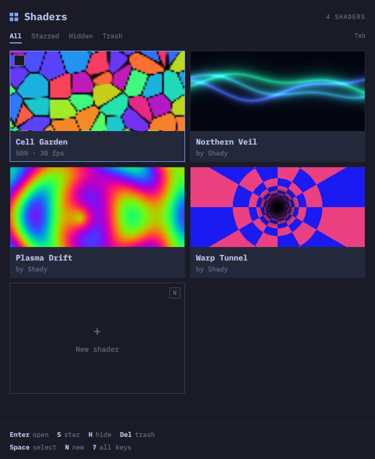
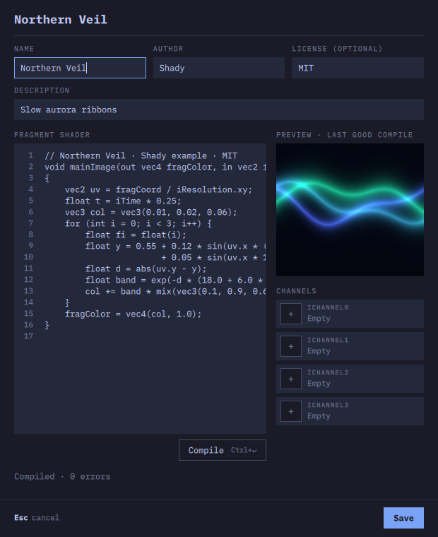

# Shady

Shadertoy-style GLSL shaders as a calm, keyboard-first screensaver and viewer for [Omarchy](https://omarchy.org).

Designed together by [Allan](https://github.com/allandehn) and [Grok](https://x.ai).

## Features

- Paste Shadertoy code (`mainImage`, `iTime`, `iResolution`, `iMouse`, `iChannel0–3`) and it runs.
- Star, hide, multi-select, Trash with undo.
- An editor with a live preview, built-in noise textures or your own images as channels, and every compile error linked to its line.
- Quality and fps per shader, auto-adapt on slow machines, and a pause for shaders that are too heavy.
- Follows your Omarchy theme live. English and Danish.

Press `?` in the app for every key.

## Install

For now, build from source (below). A pacman repo, so you can run `omarchy pkg add shady`, is coming.

## Build from source

Needs Qt 6.6+ (`qt6-base`, `qt6-declarative`, `qt6-shadertools`), `glslang`, CMake and Ninja:

    sudo pacman -S --needed qt6-base qt6-declarative qt6-shadertools glslang cmake ninja
    cmake -S . -B build -G Ninja -DCMAKE_BUILD_TYPE=Release
    cmake --build build
    sudo cmake --install build      # installs /usr/local/bin/shady

## Uninstall

    sudo rm /usr/local/bin/shady

Your shaders and settings stay until you remove them too:

- `~/.local/share/shady`: your shaders (plain `shader.glsl` + `shader.toml` folders) and the Trash
- `~/.cache/shady`: compiled shaders and preview stills (safe to delete any time)
- `~/.config/shady`: settings

## License

MIT. See [LICENSE](LICENSE). The example shaders are MIT too.
